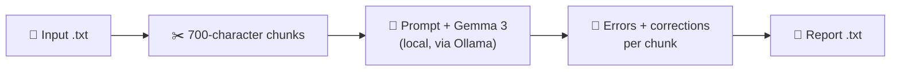

# 📝 English Error Detector (Gemma 3 + Ollama)

### Proofread academic English with a local LLM — private, no cloud, nothing leaves your machine


-4285F4?style=flat-square)


| 🔒 Private | ✅ Corrections included | 🌐 Two interfaces | 🐳 Portable |
|---|---|---|---|
| Runs on your machine through Ollama | Errors, fixes and a corrected text for every chunk | Web app and terminal script | Docker Compose with app + Ollama |

<!-- Add a screenshot of the web interface here, e.g.  -->

---

## 💡 Overview

A side project built in my spare time to answer my **personal user need**: proofreading academic drafts *without* uploading confidential, unpublished work to an online grammar checker.

A **local language model** (Gemma 3, 4B parameters, served by Ollama) reads the text paragraph by paragraph. For each chunk it returns a numbered list of English language errors, a suggested correction for each one, the chunk rewritten with all corrections applied, and a short summary of the most frequent error types. Everything runs locally; the only network access is the one-time download of the model.

> [!NOTE]
> The results come from a small language model driven by a prompt. It can miss real errors, flag correct text and change the meaning of a sentence. Treat it as a first pass, not a replacement for careful human proofreading. See **Model and Limitations** below.

## ✨ Features

- 🔒 **Local inference:** text is analysed by a model running on your own machine through Ollama.
- 📐 **Paragraph-sized chunks:** 700-character slices (roughly 100–120 words) that imitate an average academic paragraph.
- 🧾 **Structured per-chunk report:** quoted errors, suggested corrections, a fully corrected chunk and an error-type summary.
- 🌐 **Web app (Gradio):** upload, progress bar, report preview and one-click download.
- ⌨️ **Command-line script:** an interactive version for the terminal.
- 📥 **Automatic model download:** the web app pulls the model the first time it is needed.
- 🚦 **One analysis at a time:** requests are queued so the local model is never overloaded.
- 🛡️ **Clear errors:** friendly messages for missing or empty files and for an unreachable Ollama server.
- 🐳 **Docker Compose:** the app and Ollama start together, with a health check and a persistent model volume.

## 🛠️ Technical Highlights

| | Area | What this project shows |
|:---|---|---|
| 🧠 | **LLM engineering** | Structured four-section prompt, low temperature (0.1) for consistent output and a capped response length per chunk |
| 🔒 | **Privacy by design** | Fully local inference; no document is sent to a third-party API |
| 🧩 | **Architecture** | Gradio app talking to Ollama over HTTP, configurable through environment variables (`OLLAMA_HOST`, `MODEL_NAME`) |
| 🛡️ | **Robustness** | Input validation, automatic model download, clear errors when Ollama is unreachable, request queue limited to one analysis |
| 📦 | **Packaging** | Compose stack with a health check and `depends_on` ordering, a named volume for model weights and a non-root app container |
| ⚖️ | **Compliance** | Review of model terms (Gemma Terms of Use) and third-party licenses |

**Stack:** Python · Ollama · Gemma 3 · Gradio · Docker Compose

## 📋 Requirements

| Element | Version | Description |
|---|---|---|
| 🐍 **Python** | 3.10+ | Runtime (required by current Gradio) |
| 🦙 **Ollama** | Latest | Local LLM runtime; must be running (default address `localhost`, port `11434`) |
| 🧠 **Model** | `gemma3:4b-it-qat` | About 4 GB; downloaded automatically on the first analysis, or in advance with `ollama pull` |
| 🔌 **ollama** (Python) | ≥ 0.4.0 | Client library for the Ollama API |
| 🎛️ **gradio** | ≥ 5.0 | Web interface |
| 🧮 **RAM** | 8 GB recommended | Running the 4B model |
| 💾 **Disk space** | 10 GB free | Ollama, the model weights and the Docker images |
| 🌐 **Network** | First run only | One-time download of the model (and of the Ollama image, with Docker) |
| 🐳 **Docker + Compose** | Compose v2 *(optional)* | Only for the container option |

Python packages are listed in `requirements.txt`.

## 🚀 Get Started

### 💻 Run locally

1. **Install Ollama** from [ollama.com](https://ollama.com) and make sure it is running.
2. *(Optional)* Download the model in advance: `ollama pull gemma3:4b-it-qat`. If you skip this, the web app downloads it on the first analysis.

```bash
# 3. Clone the repository
git clone https://github.com/polendol/ErrorDtector.git
cd ErrorDtector

# 4. Create and activate a virtual environment
python -m venv .venv
source .venv/bin/activate          # Windows: .venv\Scripts\activate

# 5. Install the dependencies
pip install -r requirements.txt

# 6. Start the web app
python app.py
```

The app runs on `localhost`, port `7860` by default, and is only reachable from your own computer. If that port is busy, Gradio picks the next free one and prints it in the terminal. Prefer the terminal? See the **Usage** section below.

> [!TIP]
> The first analysis can take several minutes if the model has to be downloaded first. Later runs reuse it. If the app cannot reach Ollama, it shows an error with the address it tried.

### 🐳 Run with Docker

```bash
git clone https://github.com/polendol/ErrorDtector.git
cd ErrorDtector

docker compose up --build
```

Compose starts Ollama first, waits until it is healthy and then starts the web app. When the logs show that Gradio is running, the app is available on `localhost`, port `7860`. The log prints `http://0.0.0.0:7860`; that is the address inside the container and it does not work in a browser, so type `localhost` with port `7860` instead.

- The first analysis downloads the model (about 4 GB) into a named volume (`ollama_data`). It is reused on every later run.
- The provided Compose file runs Ollama on **CPU**, so analysis is slower than with a GPU.
- Stop with `Ctrl+C` and `docker compose down`. Add `-v` to also delete the downloaded model.

> [!WARNING]
> With the provided `docker-compose.yml`, port `7860` is published on all network interfaces of the host, so other devices on the same network can also reach the app, and it has no authentication. Use it on trusted networks only. To restrict it to your own computer, change the port mapping to `127.0.0.1:7860:7860`. The Ollama service itself is **not** published to the host.

## 🎮 Usage

### 🌐 Web interface

1. Upload a `.txt` file.
2. Follow the progress bar while the chunks are analysed.
3. Read the preview and download the report. It is named after your file (`my_essay.txt` → `my_essay_report.txt`).

### ⌨️ Command line

```bash
python ErrorDetector.py
```

The script asks for the name of the input `.txt` file and the name of the report to generate. The report is saved as a `.txt` file in the project.

### ⚙️ Configuration (web app)

| Variable | Default | Description |
|---|---|---|
| `OLLAMA_HOST` | `http://localhost:11434` | Address of the Ollama server (Docker Compose sets `http://ollama:11434`) |
| `MODEL_NAME` | `gemma3:4b-it-qat` | Ollama model used for the analysis |

The default is the tested configuration. Other Ollama models can be used, but report quality and format may differ.

```text
MODEL_NAME=<model-name> python app.py      # Linux / macOS
set MODEL_NAME=<model-name>                # Windows (cmd), then:
python app.py
```

> [!CAUTION]
> If you point `OLLAMA_HOST` at another machine, your text is sent to that machine. Keep the default for fully local processing.

## 📄 Example Output

```text
LANGUAGE ERROR REPORT
Model used: gemma3:4b-it-qat
Total Chunks: 2

--- CHUNK 1 ---
TEXT: <first 100 characters of the chunk>...
ANALYSIS:
1. ERRORS: <numbered list, each with the original phrase quoted>
2. SUGGESTED CORRECTIONS: <the corrected version of each error>
3. CORRECTED TEXT: <the whole chunk rewritten with all corrections applied>
4. ANALYSIS: <summary of the most frequent error types>

**************************************************
--- CHUNK 2 ---
...
```

*Illustrative. The model answers in free text, so wording and layout can vary between chunks and runs.*

| Section | Meaning |
|---|---|
| 🔎 **ERRORS** | Detected errors, numbered, with the original phrase quoted |
| 🛠️ **SUGGESTED CORRECTIONS** | A corrected version for each listed error |
| ✅ **CORRECTED TEXT** | The full chunk rewritten with all corrections applied |
| 📊 **ANALYSIS** | A brief summary of the most frequent error types |

## ⚙️ How It Works



The text is split into consecutive chunks of 700 characters. Each chunk is sent to the model with the prompt below; the model runs with a low temperature (0.1) for objectivity, and its answer is limited to about 1,000 tokens. The answers are collected into one report.

<details>
<summary>Show the prompt</summary>

```text
INSTRUCTION: Analyze the following academic text for English language errors. Provide a structured report with the following sections:

1. ERRORS: List all detected errors, numbered, with the original incorrect phrase quoted.
2. SUGGESTED CORRECTIONS: For each error listed above, provide the corrected version.
3. CORRECTED TEXT: The full original text rewritten with all corrections applied.
4. ANALYSIS: Brief summary of the most frequent error types found.

TEXT:
<chunk>

REPORT:
```

</details>

## 🧠 Model and Limitations

**Model:** [Gemma 3](https://ai.google.dev/gemma) (4B parameters), run locally through [Ollama](https://ollama.com). The model is `gemma3:4b-it-qat`, a quantization-aware-trained build with a smaller memory footprint. **No model weights are stored in this repository or in the Docker images.**

| | Design notes |
|:---|---|
| 🧪 | **Method:** prompt-based proofreading with a general-purpose LLM. There is no fine-tuning, no training data and no labelled benchmark |
| 📏 | **Chunk size:** 700 characters, chosen to resemble the length of a typical academic paragraph |
| 🇬🇧 | **Language:** English only. The prompt does not specify a variety (British or American) |

> [!WARNING]
> **A small model can be confidently wrong.** It may miss real errors, flag text that is correct, quote phrases that are not in your text, and alter technical terms or the meaning of a sentence in the corrected version. Always compare its suggestions with your original.

Other known limits:

- ✂️ **Fixed-size chunks:** cuts without overlap can split words or sentences, so the model may report an "error" at a chunk boundary that does not exist in your document.
- 📏 **Length cap:** the answer for each chunk is limited to about 1,000 tokens, so a chunk with many errors can produce an incomplete report.
- 🧠 **Small model:** a 4B model has limited reasoning and can be inconsistent between runs.
- 📝 **Free-text output:** reports are not machine-parseable and there is no document-level summary.
- 🚧 **Failed chunks:** if the model call fails, the error message is written into the report instead of stopping the run.
- 🚦 **Sequential processing:** one analysis at a time, and long documents can take a while on CPU.

## 🔒 Privacy

- 🏠 Text is analysed by a local model through Ollama; documents are never sent to a third-party service.
- 📡 The only outbound connections are the model download (and, with Docker, the image download) the first time. Afterwards the tool can work offline.
- 📊 Gradio sends anonymous usage analytics by default; disable them with `GRADIO_ANALYTICS_ENABLED=False`.
- 🗑️ **Temporary files:** the web app leaves temporary copies of uploads and reports, which are not deleted automatically. With Docker they stay inside the container and disappear with `docker compose down`.
- 📝 **Reports are as sensitive as the source:** each one contains the **complete corrected text** of your document, plus a 100-character preview and quoted phrases for every chunk.
- 💾 **Command-line reports** are saved in the project folder. Keep documents and reports in a folder that is never committed to version control.
- 🐳 **Keep your documents out of the Docker image.** The `Dockerfile` copies the whole project folder into the image, so list your documents, reports and `.venv/` in a `.dockerignore` file.
- 🌐 **Network exposure:** run locally (`python app.py`), the web app listens on `localhost` only. With Docker, the provided `docker-compose.yml` publishes port `7860` on all host network interfaces, so other devices on your network can reach it. The app has no authentication, so use Docker on trusted networks or publish the port as `127.0.0.1:7860:7860` to keep it private. The Ollama API is not published.
- 🔌 **Remote Ollama:** if you set `OLLAMA_HOST` to another machine, your text travels to that machine.

## 🗂️ Project Structure

```text
.
├── app.py                # Gradio web app
├── ErrorDetector.py      # Interactive command-line version
├── requirements.txt      # Python dependencies
├── Dockerfile            # python:3.12-slim, non-root user (web app)
├── docker-compose.yml    # Web app + Ollama, health check, model volume
├── LICENSE               # MIT License
└── README.md             # This file
```

## 🗺️ Roadmap

- [ ] 📊 Evaluate against a labelled error-correction dataset (precision, recall, F1)
- [ ] 🎨 Side-by-side view that highlights what changed between the original and the corrected text
- [ ] 🧾 Structured (JSON) output and a document-level summary
- [ ] ✂️ Paragraph- or sentence-aware chunking with overlap, to avoid false errors at chunk boundaries
- [ ] 🇬🇧 Choose the language variety (British or American English)
- [ ] 🔀 Choose the model from the web interface
- [ ] 🧱 Shared core module for the web app and the command-line script
- [ ] 🧹 Automatic cleanup of temporary files
- [ ] 📑 `.docx` and `.pdf` input
- [ ] ⚡ Optional GPU support in Docker Compose
- [ ] 📌 Pinned dependency versions for reproducible builds
- [ ] ✅ Automated tests and CI

## ⚠️ Responsible Use

> [!CAUTION]
> This tool gives suggestions generated by a small language model. Review every change before accepting it, especially in technical terms, numbers and citations. Check the policy of your journal, conference or institution on AI-assisted editing, since some require it to be disclosed.

## ⚖️ License

Released under the **[MIT License](LICENSE)**. Copyright (c) 2026 Paulina Olender.

The MIT License covers **only this project's own code and documentation**. Third-party models and libraries are not redistributed here and keep their own terms.

> This software is provided "as is", without warranty of any kind. This is an independent project, not affiliated with or endorsed by Google, Ollama, Gradio or Docker. Gemma is a trademark of Google. All product names and trademarks belong to their respective owners.

### 📜 Third-Party Licenses

| Component | Role | License | Notes |
|---|---|---|---|
| [Gemma 3](https://ai.google.dev/gemma) (`gemma3:4b-it-qat`) | Language model | ⚠️ **[Gemma Terms of Use](https://ai.google.dev/gemma/terms)** and **[Prohibited Use Policy](https://ai.google.dev/gemma/prohibited_use_policy)**, a custom license and not an open-source one (terms last modified 1 Apr 2026, checked 13 Oct 2026) | Not included in this repository or in any image. Each user downloads the model through Ollama and is bound by these terms. |
| [Ollama](https://github.com/ollama/ollama) | Local LLM runtime | MIT | Also distributed as the `ollama/ollama` Docker image |
| [ollama-python](https://github.com/ollama/ollama-python) | Python client | MIT | |
| [Gradio](https://github.com/gradio-app/gradio) | Web interface | Apache 2.0 | |

> [!NOTE]
> The Gemma terms apply to anyone who uses the model, including people who use it through a service you host, and other Gemma generations may be under different terms. Read them before hosting this app for others or switching models.

The Docker setup is built locally from the official `python:3.12-slim` image (Python Software Foundation License, plus Debian packages under their own licenses) and the official `ollama/ollama` image; no image is distributed with this repository.

## 🙏 Acknowledgments

Thanks to the **Google DeepMind** team for Gemma, to the **Ollama** maintainers for making local models easy to run, and to the **Gradio** community.

## 📚 Citation

If you build on the underlying model, please cite:

- Gemma Team, Google DeepMind. *Gemma 3 Technical Report.* [arXiv:2503.19786](https://arxiv.org/abs/2503.19786)

## 👤 Author

**`Paulina Olender`** — NLP / Machine Learning

Feedback, issues and suggestions are welcome. If this tool is useful to you, a ⭐ is appreciated.
